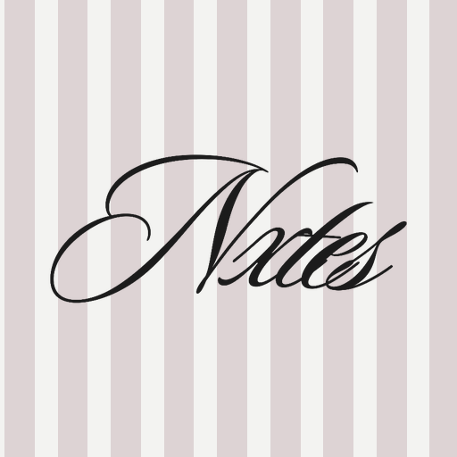

<div align="center">



# Nxtes

<!-- Project status -->
[](https://github.com/AallynReed/Nxtes/releases/latest)

[](https://github.com/AallynReed/Nxtes/releases)


<!-- Platforms -->


<!-- Tech stack -->


<!-- Project meta -->

[](https://foxhearth.com/discord)
[](https://foxhearth.com/projects/nxtes)

</div>

Nxtes is a free, open-source handwriting and PDF annotation app for Android tablets, with a sync
server you can host yourself. Every feature is free, with no ads.

**Status:** 1.1. You can import PDFs and create notes from generated templates (or
your own images and PDFs), organise them in folders, open several at once in tabs, and write on them
with a stylus or finger: pens, highlighter, eraser, undo and redo, saved automatically. The page
navigator adds, reorders, turns, duplicates, copies and moves pages; bookmarks, outlines, covers,
duplicate and merge are in too. The editing tools are in: lasso, shapes and shape recognition, text
boxes with your own fonts, images with camera and crop, sticky notes, sticker packs, masking with
correct rates, a laser pointer, handwriting-to-text conversion (on request, or by itself whenever
you pause), and a highlighter that snaps to PDF text and to handwriting. The screens follow Flexcil's layout
([UI](docs/ui.md)). The viewer scrolls down or across, page by page or continuously, one or two
pages at a time, with dark pages, read-only mode, full screen, multi-finger undo and redo,
annotation and search panels, and full-text search across the library. Recording audio while
writing works too, in the background, with playback at 0.5× to 2×, replay of the writing in step
with the sound, and tap-on-ink to hear that moment. Documents export as PDFs that keep their
original pages (or flattened) and as pictures, images import as documents, and the whole library
backs up to one zip. Sign in from Settings to sync the library between devices, live while the
app is open and hourly in the background, through the official server or [your own](server/README.md).
Exported PDFs can be shared as web links that open in any browser, and Flexcil backups import with
their folders, pages, writing and links.

Handwriting is read on the device by Google's ML Kit, the one closed-source part of the app: each
language's recognition model downloads from Google the first time it's used.

Signed builds of each version are attached to the [GitHub releases](https://github.com/AallynReed/Nxtes/releases).
1.0.0 and later can't install over the 0.x debug builds: uninstall those first, then sign in or
restore a backup to get the library back.

- [Feature spec](docs/spec.md): what Nxtes will do
- [Architecture and plan](docs/plan.md): how it's built, plus the milestones
- [UI](docs/ui.md): screen layouts, matching what Flexcil users already know

## Layout

| Path | Contents |
|---|---|
| `android/` | The Android app (Kotlin, Jetpack Compose) |
| `server/` | The sync server (Rust, axum) |
| `docs/` | Spec and plan |

## Building

You need JDK 17 or newer, the Android SDK and stable Rust.

```powershell
cd android; .\gradlew.bat assembleDebug
```

A signed release build (`assembleRelease`) reads the keystore from `android/keystore.properties`,
which stays out of git; without it the release APK is unsigned.

```properties
storeFile=nxtes-release.jks
storePassword=...
keyAlias=nxtes
keyPassword=...
```

```powershell
cd server; cargo test
```

The server listens on `127.0.0.1:8080` by default; [server/README.md](server/README.md) covers
its settings, the admin commands and running it with Docker.

## License

[AGPL-3.0](LICENSE). If you run a modified Nxtes server for other people, you must publish your
changes.
